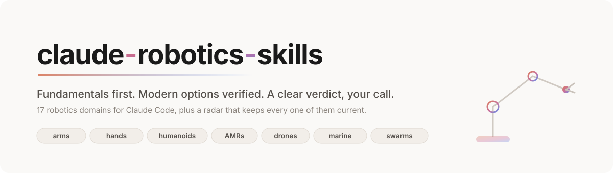
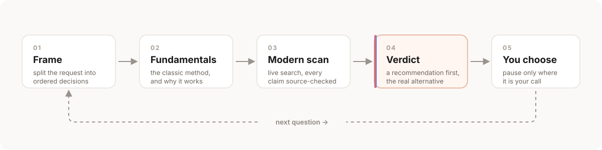
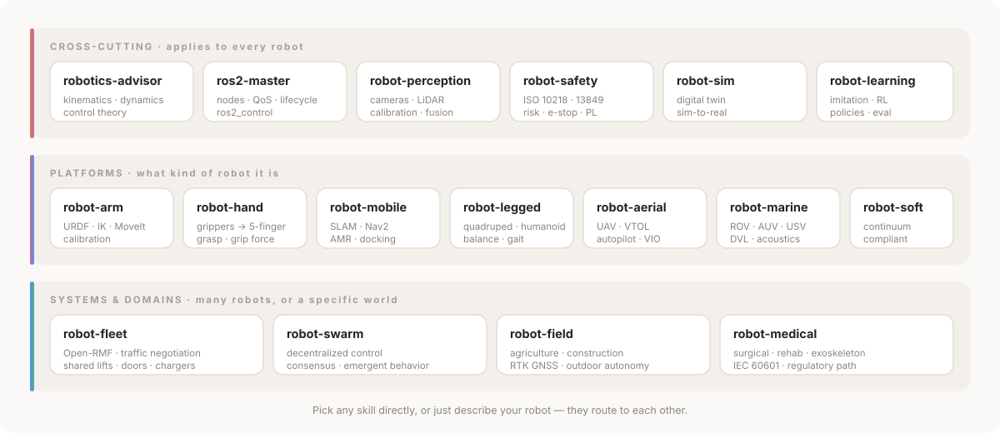

<div align="center">



[](LICENSE)
[](https://github.com/joey114132/claude-robotics-skills)
[](#the-skills)
[](#why-youd-trust-it)

**[Install](#install) · [The skills](#the-skills) · [Agents and teams](#agents-and-teams) · [How it works](#how-it-works) · [Why you'd trust it](#why-youd-trust-it) · [Third-party notices](#third-party-notices)**

</div>

---

## The problem

Ask any AI assistant *"which IK solver should I use?"* and you get a confident paragraph. It names a library that was archived two years ago, quotes a spec it half-remembers, and skips the textbook method that would have been the right answer for your 6-DOF arm.

Robotics punishes that. The field is old enough to have deep fundamentals and fast enough that half the tooling you remember is stale.

**These skills fix both ends.** Every answer starts from the classic method and *why* it works, then adds modern alternatives that were verified against live sources in that same conversation. Then it gives a verdict, names the real alternatives, and leaves the call to you.

<div align="center">

</div>

---

## The skills

<div align="center">

</div>

You never need to remember which one to call. Describe your robot and the right skill triggers itself, then hands off to its neighbors as the problem moves.

<details>
<summary><b>Cross-cutting</b> — applies to every robot</summary>

| Skill | What it decides with you |
|-------|--------------------------|
| [`robotics-advisor`](skills/robotics-advisor/SKILL.md) | The method itself: kinematics, dynamics, control theory. Grounds the choice in fundamentals before any library gets named. |
| [`ros2-master`](skills/ros2-master/SKILL.md) | Architecture: topic vs service vs action, lifecycle nodes, QoS, executors, ros2_control. |
| [`robot-perception`](skills/robot-perception/SKILL.md) | Sensing: camera/LiDAR/depth choice, intrinsic and hand-eye calibration, 3D perception, sensor fusion, time sync. |
| [`robot-safety`](skills/robot-safety/SKILL.md) | Keeping people intact: risk assessment, ISO 10218 / TS 15066 limits, performance levels, e-stop architecture, certification path. |
| [`robot-sim`](skills/robot-sim/SKILL.md) | Simulation strategy: which simulator, contact fidelity, domain randomization, and whether sim results actually predict hardware. |
| [`robot-learning`](skills/robot-learning/SKILL.md) | Whether to learn at all — then demonstrations, policy class, evaluation protocol, and a safety wrapper the policy can't override. |
| [`physical-ai-harness`](skills/physical-ai-harness/SKILL.md) | What wraps a learned model before it drives hardware: output region, inference budget, stale-input revocation, fallback controller, and one gate node with one profile. |
| [`robot-data-health`](skills/robot-data-health/SKILL.md) | Which recorded rosbag2 episodes are safe to train on: camera coverage, gaps, shared gaps across cameras, duplicate publishers, clock offset. Ships a read-only scan script. |
| [`video-relay-cadence`](skills/video-relay-cadence/SKILL.md) | Why a relayed camera feed judders when topic Hz looks fine, and which max FPS to pick. Ships a probe and fps calculator. |
| [`robot-audit-team`](skills/robot-audit-team/SKILL.md) | When to fan an audit of a robot command path out across four harness axes with blind verification, and how to run it. See [Agents and teams](#agents-and-teams). |
| [`robot-autopilot`](skills/robot-autopilot/SKILL.md) | A one-shot "diagnose and fix this" run: triage, specialists, blind verification, test-first patches in worktrees reviewed by a critic, and a report that leaves every hardware command to you. |
| [`robot-preflight-team`](skills/robot-preflight-team/SKILL.md) | One read-only go/no-go sheet before a session on a shared robot: a verdict per planned command, drift across model copies, host config and clock agreement, and evidence that a gain change was simulated first. A GO covers files and records, never the robot itself. |

</details>

<details>
<summary><b>Platforms</b> — what kind of robot it is</summary>

| Skill | What it decides with you |
|-------|--------------------------|
| [`robot-arm`](skills/robot-arm/SKILL.md) | URDF → IK → hardware interface → MoveIt 2 → calibration → safety, in dependency order. |
| [`robot-hand`](skills/robot-hand/SKILL.md) | Parallel-jaw through 5-finger anthropomorphic: grasp strategy, grip force control, in-hand manipulation, teleop retargeting. |
| [`robot-mobile`](skills/robot-mobile/SKILL.md) | SLAM vs prebuilt maps, localization, Nav2 planners and costmaps, docking, multi-floor. |
| [`robot-legged`](skills/robot-legged/SKILL.md) | Quadrupeds and humanoids: balance criteria, gait and footstep planning, locomotion MPC vs RL, loco-manipulation. |
| [`robot-aerial`](skills/robot-aerial/SKILL.md) | Multirotor vs VTOL, autopilot stack, GPS-denied flight, payload and endurance budget, failsafes. |
| [`robot-marine`](skills/robot-marine/SKILL.md) | ROV vs AUV vs USV, thruster allocation, underwater localization without GPS, pressure and corrosion. |
| [`robot-soft`](skills/robot-soft/SKILL.md) | Soft and continuum robots: actuation, modeling limits, soft sensing, and when compliance genuinely beats rigid. |

</details>

<details>
<summary><b>Systems &amp; domains</b> — many robots, or a specific world</summary>

| Skill | What it decides with you |
|-------|--------------------------|
| [`robot-fleet`](skills/robot-fleet/SKILL.md) | Open-RMF, traffic negotiation, shared lifts and doors and chargers, task dispatch, DDS discovery at scale. |
| [`robot-swarm`](skills/robot-swarm/SKILL.md) | Decentralized control, consensus, emergent behavior — and the honest question of when a swarm beats a coordinator. |
| [`robot-field`](skills/robot-field/SKILL.md) | Outdoor autonomy: agriculture, construction, inspection, RTK GNSS and its failure modes, environmental hardening. |
| [`robot-medical`](skills/robot-medical/SKILL.md) | Surgical, rehab, assistive: RCM mechanisms, physical human-robot interaction, and the regulatory path. |
| [`robotics-radar`](skills/robotics-radar/SKILL.md) | The collection's own maintenance sweep — see [Self-maintaining](#self-maintaining). |

</details>

---

## Agents and teams

Ten agents and three workflows ship with the skills. Nine agents have only `Read`, `Grep` and `Glob`. `robot-fix-builder` is the only one that writes: it adds `Edit`, `Write` and `Bash` (to run its tests), and the autopilot workflow runs it only inside a git worktree. Each agent's description says when to call it.

| Agent | Call it when |
|-------|--------------|
| [`harness-axis-auditor`](agents/harness-axis-auditor.md) | One axis (projection, isolation, input staleness or transfer) of a ROS 2 actuator path needs auditing against the harness checklist. Reads the project's decision records first and cites a real file and line for every finding. |
| [`finding-skeptic`](agents/finding-skeptic.md) | A single finding needs a blind check. It tries to refute the claim, and defaults to "not real" when it cannot confirm. |
| [`robot-fault-hunter`](agents/robot-fault-hunter.md) | An intermittent fault has no known cause yet (camera freezes, periodic dropouts). Returns competing hypotheses with read-only falsifying checks and one capture plan, and never touches the robot. |
| [`robot-triage-router`](agents/robot-triage-router.md) | A symptom or goal has to be classified (live fault, intermittent fault, recorded data, video relay, policy deployment, code-path audit, design question) and turned into a plan of specialists. Read-only; returns JSON. |
| [`robot-fix-builder`](agents/robot-fix-builder.md) | One verified defect needs a minimal patch and a test that fails before and passes after. The only agent that can write, and it runs in an isolated git worktree. It never touches hardware and never pushes. |
| [`robot-change-critic`](agents/robot-change-critic.md) | A patch needs review against the harness checklist, the project's decision records and its tests. Read and search tools only; returns PASS or failures with file and line. |
| [`robot-command-gate`](agents/robot-command-gate.md) | Commands are about to be typed against a robot, a robot PC or a bus (CAN frames, topic publishes, remote shells, service restarts, a flash). Sorts each one into READ_ONLY, NEEDS_APPROVAL or FORBIDDEN from the project's bus map and shared-host list. It classifies and never runs anything. |
| [`robot-model-drift-auditor`](agents/robot-model-drift-auditor.md) | The same robot model exists in several copies (laptop and robot PC checkouts, installed share directories, URDF next to MJCF). One call takes one lens (limits, inertia, collision or structure) and lists every field where the copies disagree. |
| [`robot-sync-config-auditor`](agents/robot-sync-config-auditor.md) | A multi-host ROS 2 session is about to start, or hosts were added or re-imaged. Compares RMW and DDS settings, interface binding, MTU and kernel buffers, and time sources across hosts, and hands back read-only capture commands. |
| [`robot-gain-change-gate`](agents/robot-gain-change-gate.md) | A gain, limit, filter or controller change is about to reach hardware. Checks that a simulation run exists for exactly that parameter file, with acceptance criteria written first and a bounded step and rollback. Returns PASS or BLOCK, and never proposes gain values. |

[`workflows/robot-harness-audit.js`](workflows/robot-harness-audit.js) is the wiring: four axis auditors in parallel, deduplication in code, then one skeptic per high or medium finding. The [`robot-audit-team`](skills/robot-audit-team/SKILL.md) skill says when that is worth its cost. In one comparison on a dual-arm teleoperation bridge it found 16 distinct open issues against 8 for a single agent, at about three times the tokens. That was one task and one run, so it is not a general benchmark.

[`workflows/robot-autopilot.js`](workflows/robot-autopilot.js) runs the whole loop from one stated symptom: triage, the chosen specialists, one blind skeptic per high or medium finding, then up to five confirmed findings each get a test-first patch from `robot-fix-builder` in its own worktree and up to three rounds of review by `robot-change-critic`. The caps live in the script. Everything that would restart something, publish to a robot, switch a controller, change a gain, send bus frames or push is left to you as an exact command in the report's pending approvals, each tagged READ_ONLY, NEEDS_APPROVAL or FORBIDDEN by `robot-command-gate`. The [`robot-autopilot`](skills/robot-autopilot/SKILL.md) skill says when to use it. Both workflows take an `agentPrefix` argument. The default, `robotics-skills:`, fits a plugin install; pass `""` when the agents are installed bare (symlinks, or `--plugin-dir`). It has no benchmark yet.

[`workflows/robot-preflight.js`](workflows/robot-preflight.js) is the wiring for the [`robot-preflight-team`](skills/robot-preflight-team/SKILL.md) skill. It needs a confirmed per-robot profile (bus map, shared hosts, canonical model copy, speed caps), or it drafts one and stops for a human to read. Then the command gate, four drift auditors (one per lens), the sync auditor and the gain gate run in parallel, only where they apply, followed by one blind skeptic per high or medium finding. Three things are computed in code: the verdict, the caps (14 agent calls at most) and a file-hash comparison taken before and after the run. The hashes come from you, because the script has no shell. It takes the same `agentPrefix` argument and has no benchmark yet.

---

## How it works

Each skill works through the same sequence internally and answers in one pass.

**1 · Frame** — split the request into decisions in dependency order. Broad requests start upstream, because downstream choices depend on the answer.

**2 · Fundamentals** — the classic method and *why it's shaped that way*. Terminology gets defined in plain language before the math.

**3 · Modern scan** — a live search, every invocation. Each skill ships a dated snapshot of its field, but treats it as a starting point to re-verify, never as an answer.

**4 · Verdict, then options** — the recommendation comes first with the reason. Where the tradeoff is real, the strongest alternative follows, and the classic method stays on the table.

**5 · You choose where the choice is yours** — in a live session, the skill stops at a choice that is truly yours (irreversible, budget, hardware you own) after stating its recommendation. Everywhere else it delivers the whole answer and closes with the few open questions that would change it.

Inside a `/loop` or a scheduled run, each skill takes its recommended option at every decision and reports the decisions it made at the end. Guided, Fast-forward and Audit modes exist only in [`robotics-radar`](skills/robotics-radar/SKILL.md), the maintenance sweep.

---

## Why you'd trust it

**Nothing is presented that wasn't checked.** Every entry in every landscape snapshot carries a live source URL (an `arxiv.org/abs` link for papers). A link checker ships with the repo:

```sh
python3 scripts/check_sources.py            # every skill, live URL check
python3 scripts/check_sources.py --offline  # format only, no network
```

Standard library only. It exits non-zero on an entry without a source URL, a dead link, or a snapshot older than 180 days, so you can drop it in CI.

**Findings that only exist because it verifies.** The snapshots record things a model answering from memory gets wrong: that `osrf/rmf_core` — the Open-RMF repo most training data still cites — was archived in 2021 and development moved to the `open-rmf` org. Archived-but-still-ranking repos are the exact failure this collection is built to prevent.

**Measured over nine blind rounds, and the result is parity. This project previously reported a headline that was wrong.** Fourteen questions, each answered with and without the skills, scored by a judge who did not know which was which. Latest round: **93% vs 93%.**

Two effects are large and reproduce; they cancel. The skills **cite about 20 points better** (100% vs 79% on verifiable sources — they pass through the source URL their snapshots already hold, instead of asserting facts bare) and score **21 to 31 points worse on fabrication discipline** (29 in the latest round). That benchmark disabled their verify-then-speak mechanism throughout. On catching planted expert traps, explaining the principle, and giving real options they run at 100%.

**[EVAL.md](EVAL.md)** has the parts that matter more than the score: why an earlier "8 wins vs 4" headline was retracted as noise (wins swing 4-to-8 across rounds on identical questions), why the "fabrication" criterion turned out not to be measuring fabrication — 29 of 29 cited paper IDs came from verified snapshots, none invented — and the four fixes that never moved it. A benchmark that only ever shows the project winning is marketing.

---

## Measuring it

[EVAL.md](EVAL.md) holds the nine-round blind benchmark history. The `evals/` directory holds the current suite for `claude plugin eval`: 14 trap cases that grade answer quality and 42 routing cases that check the right skill fires. EVAL.md has the exact commands and results.

First results, 2026-10-02 (plugin 0.7.0, one run per arm, skill / baseline):

| Grader | Opus 5.5 | Sonnet 5.5 |
|---|---|---|
| Caught the trap | 14/14 / 14/14 | 14/14 / 14/14 |
| Explained the principle | 14/14 / 13/14 | 13/14 / 14/14 |
| Committed to a recommendation | 14/14 / 14/14 | 14/14 / 14/14 |
| Sourced decaying figures | 9/14 / 9/14 | 7/14 / 9/14 |

Both current models catch every trap without the skills, so this suite sits at the ceiling and shows parity again. Routing held at 60 of 60 runs before and after the description cleanup, which cut the always-on cost from about 4,850 to 3,975 tokens.


---

## Self-maintaining

Robotics snapshots rot. Two mechanisms keep these from going stale:

**Per-invocation.** Every skill re-verifies live before answering. In a checkout, or the manual symlink install below, it also rewrites its own snapshot in place when reality has moved past it. A plugin install copies the files into a versioned cache directory, so a rewrite there lasts only until the plugin updates, and it never reaches the repo or other users. Durable refreshes come from running `robotics-radar` in a checkout and pushing the result.

**Periodic sweeps.** [`robotics-radar`](skills/robotics-radar/SKILL.md) orchestrates parallel research agents across stale domains, then a second adversarial pass that tries to *disprove* each finding and deletes what it can't confirm. It also hunts for coverage gaps — robot types and paradigms no skill covers yet — and adds new skills for the ones that turn out to be real and durable.

```
Update the robotics skills          # triage, sweep, verify, report the diff
Audit the robotics skills           # read-only staleness and dead-link report
```

Run it on a schedule in a checkout and the collection keeps itself current without you.

---

## Install

```
/plugin marketplace add joey114132/claude-robotics-skills
/plugin install robotics-skills@claude-robotics-skills
```

That's it. Robotics topics trigger the right skill from the next session — you never type a skill name.

<details>
<summary>Manual install without the plugin system</summary>

```sh
git clone https://github.com/joey114132/claude-robotics-skills.git ~/claude-robotics-skills
mkdir -p ~/.claude/skills
for s in ~/claude-robotics-skills/skills/*/; do
  ln -sfn "${s%/}" ~/.claude/skills/"$(basename "$s")"
done
```

</details>

---

## Contributing

New skills follow the house structure: a How to answer block copied from a sibling skill, a decision sequence in dependency order, a Modern scan that re-verifies live, and a Gotchas section of real, expensive traps — not generic advice. Landscape entries need a live source. See [CLAUDE.md](CLAUDE.md) for the conventions and run `scripts/check_sources.py` before opening a PR.

## Third-party notices

This repository is MIT-licensed ([LICENSE](LICENSE)). Nothing below was copied into it as code or text. Each row names a project or paper whose idea an agent or skill reimplements in its own words, with the licence GitHub reports for it (`gh api repos/<owner>/<repo>`, read on 2026-10-13).

| Used in | Source | Licence | What was taken |
|---|---|---|---|
| [`agents/robot-command-gate.md`](agents/robot-command-gate.md) | [KumarRobotics/RoboGuard](https://github.com/KumarRobotics/RoboGuard) | MIT | The idea of testing a proposed action against explicit, machine-checkable rules instead of trusting whoever proposed it. |
| [`agents/robot-command-gate.md`](agents/robot-command-gate.md) | [zhinkgit/embeddedskills](https://github.com/zhinkgit/embeddedskills) | MIT | Cited as the source of the passive-capture and decode side of CAN tooling that the gate classes as read-only. The send path is what the gate refuses. |
| [`agents/robot-model-drift-auditor.md`](agents/robot-model-drift-auditor.md) | [kevinxqiu/debate2create](https://github.com/kevinxqiu/debate2create) | Apache-2.0 | The one-criterion-per-judge panel, with file comparison in place of simulator scoring. |
| [`agents/robot-gain-change-gate.md`](agents/robot-gain-change-gate.md) | [arXiv 2607.26594](https://arxiv.org/abs/2607.26594), "A Physics-Informed Framework for PID Tuning of Chemical Processes Using Large Language Model Agents" | paper | Response-feature summaries, written acceptance criteria, and stability that cannot be traded against performance. |
| [`agents/robot-gain-change-gate.md`](agents/robot-gain-change-gate.md), [`skills/robot-preflight-team`](skills/robot-preflight-team/SKILL.md) | [arXiv 2606.08610](https://arxiv.org/abs/2606.08610), "HARBOR: A Harness Framework for Agentic Robot Reinforcement Learning" | paper | A stage that advances only through an executable gate, and file-based stage handoffs. |
| [`agents/robot-gain-change-gate.md`](agents/robot-gain-change-gate.md) | [arXiv 2511.22975](https://arxiv.org/abs/2511.22975), "An LLM-Assisted Multi-Agent Control Framework for Roll-to-Roll Manufacturing Systems" | paper | Cited as consistent with the simulate, safety-check, then apply order. The order itself is this repository's inference. |
| [`skills/robot-preflight-team`](skills/robot-preflight-team/SKILL.md) | [arXiv 2607.13049](https://arxiv.org/abs/2607.13049), "SPINE: Bridging the Cyber-Physical Gap with Agentic AI" | paper | A profile builder that compiles robot-specific context before debugging starts. |
| [`skills/robot-preflight-team`](skills/robot-preflight-team/SKILL.md) | [wshobson/agents](https://github.com/wshobson/agents/tree/main/plugins/agent-teams) | MIT | File-ownership boundaries and a read-only reviewer role. |
| [`skills/robot-preflight-team`](skills/robot-preflight-team/SKILL.md) | [Yeachan-Heo/oh-my-claudecode](https://github.com/Yeachan-Heo/oh-my-claudecode) | MIT | A verify stage that escalates by risk. |

Papers carry no software licence, and no paper text is reproduced. Paper titles were read from the arXiv API on 2026-10-13. The licence column comes from the GitHub API and was not checked against each repository's LICENSE file.

## License

[MIT](LICENSE)
